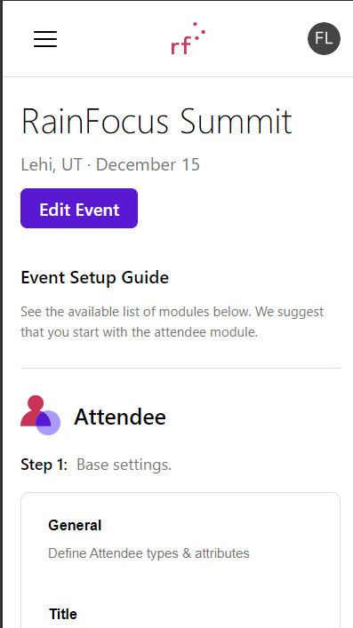
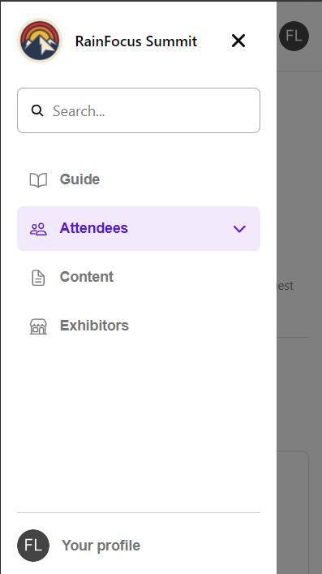
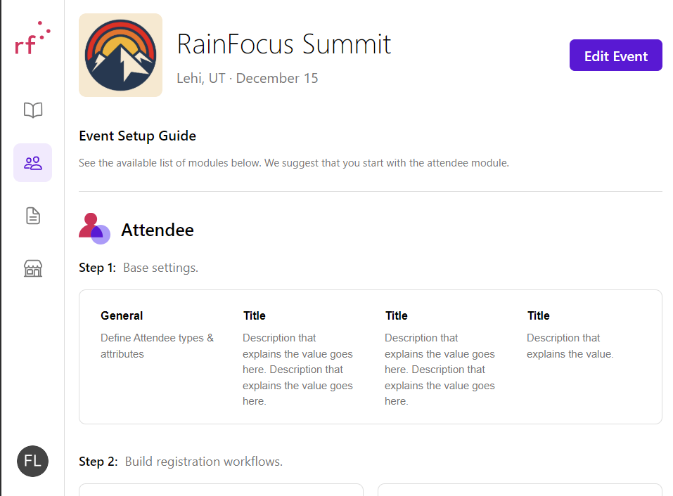
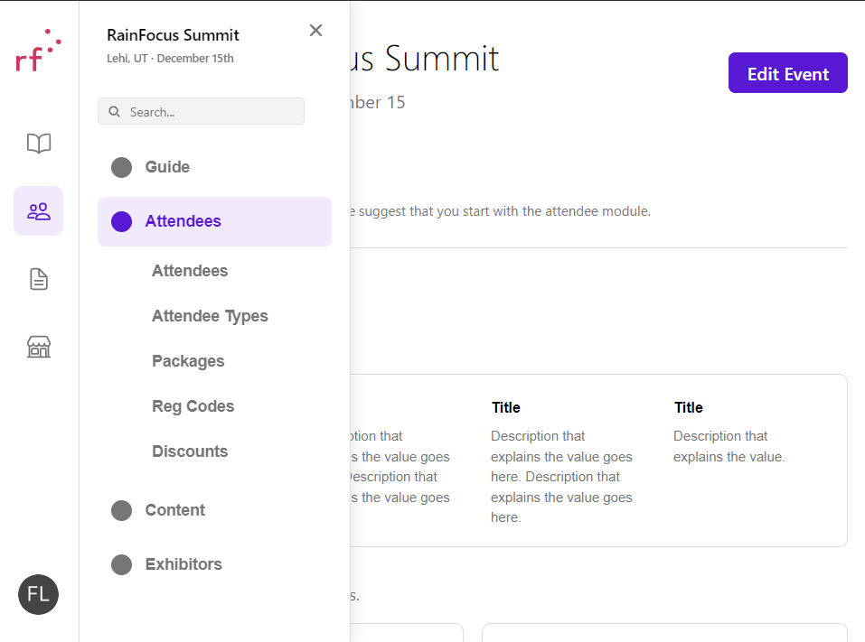
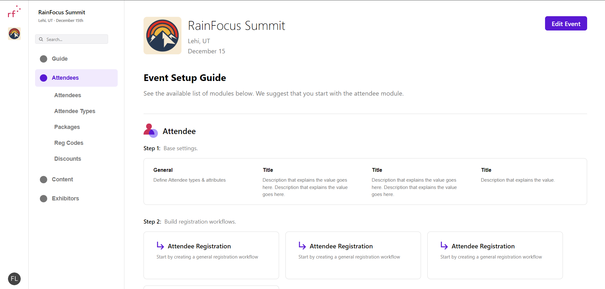

# RainFocus Dashboard Mockup

A responsive frontend recreation of a RainFocus event management dashboard, built with React and SCSS. The project focuses on matching a provided design across mobile, tablet, and desktop screen sizes.

## Technologies

- **React** – Component-based UI development
- **JavaScript (JSX)** – Component logic and interactions
- **SCSS** – Responsive styling, variables, and nested selectors
- **React Icons** – Navigation icons
- **Vite** – Development and build tooling

## Features

- **Responsive layout:** Customized dashboard and navigation layouts for mobile, tablet, and desktop.
- **Interactive navigation:** Mobile drawer and expandable tablet sidebar with hover effects and selected-item styling.
- **Reusable components:** Event information, setup instructions, and attendee cards.
- **Accessibility:** Semantic HTML, ARIA attributes, keyboard navigation, and visible focus indicators.
- **Consistent styling:** Shared SCSS variables and reusable design patterns.

## Getting Started

Install dependencies:

```bash
npm install
```

Start the development server:

```bash
npm run dev
```

Open the local URL provided by Vite.

## Mobile view/Navigation




## Tablet




## Desktop



## Notes

This is a frontend-only UI mockup. Navigation items and dashboard actions are primarily presentational and are not connected to a backend.
